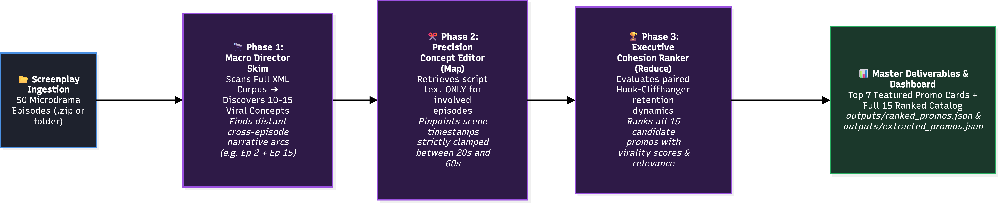
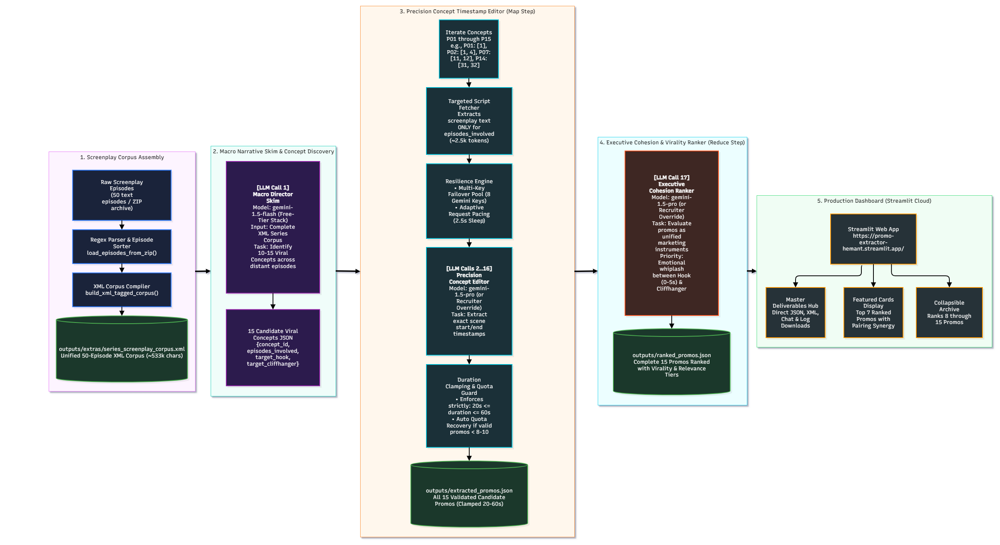

# 🎬 Context-Aware Microdrama Promo Extractor

[](https://promo-extractor-hemant.streamlit.app/)
[](https://www.python.org/)
[](https://github.com/BerriAI/litellm)
[](https://ai.google.dev/)
[]()

> **Live Production Deployment**: [https://promo-extractor-hemant.streamlit.app/](https://promo-extractor-hemant.streamlit.app/)

---

## 🌟 Executive Overview

In the rapidly exploding microdrama streaming sector (**ReelShort, DramaBox, ShortMax, Kuku TV**), short-form marketing promos dictate user acquisition and retention. Microdrama viewers decide whether to swipe or stay within the **first 3 seconds**.

Standard linear text-chunking algorithms fail because the most viral promotional arcs span across **distant episodes**—for instance, an agonizing public humiliation or theft of an heirloom in **Episode 2** that pays off with ruthless vindication in **Episode 15**. 

The **Context-Aware Microdrama Promo Extractor** solves this using a **Concept-Driven Map-Reduce architecture**:
1. **Macro Skim**: Ingests the complete series corpus in structured XML to discover viral narrative arcs across distant episodes.
2. **Precision Extraction**: Focuses LLM context strictly on the involved episodes to extract exact scene timestamps clamped between **20 and 60 seconds**.
3. **Cohesion & Virality Ranking**: Evaluates each cut as a unified marketing asset, prioritizing the emotional whiplash between the opening **Hook (0–5s)** and closing **Cliffhanger**.

---

## 🏛️ End-to-End Architecture & Workflow

### 1. High-Level Conceptual Overview


### 2. Detailed Technical Engineering Pipeline


---

## ⚡ Core Engineering Highlights

### 1. Multi-Key Failover Pool & Rate-Limit Elimination
- **The Problem**: Rapid sequential calls against free-tier Google AI Studio endpoints quickly trigger **HTTP 429 ("Too Many Requests")** and **HTTP 503 ("Service Unavailable")** due to the strict 15 RPM limit.
- **The Solution**: 
  - [`APIKeyPool`](llm_provider.py): Supports up to **8+ Gemini API keys**. If a key encounters rate limits (429) or quota depletion, it is placed on a temporary 60-second cooldown, and the engine rotates instantaneously to the next available healthy key.
  - **Adaptive Pacing**: Configurable request sleep (defaults to 2.5s) to stay beneath RPM ceilings.
  - **UI Key Masking**: Built-in `🔒 Hide / Mask Keys` toggle using password bullets so credentials are never exposed during screen sharing, recordings, or presentations.

### 2. Distant Cross-Episode Splicing
- Enables pairing narrative triggers across distant boundaries (e.g. Episode 2 and Episode 15).
- Rather than feeding the entire 60k-character script repeatedly, the **Concept Editor (Map step)** dynamically retrieves script text *only* for `episodes_involved`, reducing per-call token footprint to ~2.5k tokens and dropping latency to ~1.4 seconds.

### 3. Strict 20–60s Duration Clamping & Quota Guarantee
- Clamps total combined duration between **20 and 60 seconds**.
- An automated **Quota Recovery Routine** runs if candidate omissions threaten the minimum deliverable threshold, guaranteeing **8–10+ valid promos**.

### 4. Cohesive Unit Ranking (All 15 Promos Ranked)
- Evaluates candidate promos as unified marketing instruments.
- Ranks all 15 candidate promos in `outputs/ranked_promos.json` with virality scores (1–100), descriptive relevance tiers, and pairing synergy analyses.
- The web application highlights the **Top 7 cuts** as featured cards, with an expandable container for **Ranks 8–15**.

### 5. Dynamic Model Routing & Evaluator Key Injection
- **Optimized Free-Tier Stack (Default)**: Automatically pairs `gemini-1.5-flash` for high-throughput macro skimming (Stage 2) with `gemini-1.5-pro` for deep reasoning in precision timestamp editing (Stage 3) and executive ranking (Stage 4).
- **Recruiter Evaluator Mode**: Allows evaluators to inject custom API keys (`OPENAI_API_KEY`, `ANTHROPIC_API_KEY`, `GEMINI_API_KEY`) and swap models either globally (`gpt-4o`, `claude-3-5-sonnet`) or per-stage via **Advanced Task Routing**.
- **Automated Fallback to Free Tier**: If a recruiter's custom model encounters authentication, quota, or network failure, the engine automatically falls back to the default free-tier stack (`gemini-1.5-pro` / `gemini-1.5-flash` / `gemini-3.1-flash-lite`), ensuring the pipeline never crashes.


---

## 📂 Project Structure & Deliverables

```text
PromoExtractor/
├── app.py                           # High-end Streamlit web dashboard
├── promo_engine.py                  # Core Map-Reduce extraction & ranking engine
├── llm_provider.py                  # LiteLLM provider, multi-key pool, dynamic routing & JSON parser
├── test_pipeline.py                 # Automated unit & deliverables verification test suite
├── requirements.txt                 # Python dependencies
├── README.md                        # Master project documentation
│
├── data/                            # 50 screenplay episodes (1-2 min each)
│   ├── episode-001.txt
│   ├── ...
│   └── episode-050.txt
│
├── docs/                            # Project documentation & presentation assets
│   ├── prompt_templates.md          # Complete catalog of all prompts with headings
│   ├── presentation_tour_script.txt # 2.5-minute presentation script
│   └── architecture_flowchart.mmd   # Mermaid architecture diagram script
│
└── outputs/                         # Primary project deliverables
    ├── extracted_promos.json        # All 15 candidate promos under 60 seconds
    ├── ranked_promos.json           # All 15 promos ranked with virality & relevance tiers
    ├── pipeline_run.log             # Execution audit log tracking key rotation & latency
    │
    └── extras/                      # Supplemental deliverables & full audits
        ├── series_screenplay_corpus.xml   # Unified XML corpus (50 episodes, 533k chars)
        ├── llm_chats.json                 # Single master file containing all 17 LLM chats
        ├── prompt_templates.md            # Master prompt templates catalog
        ├── presentation_tour_script.txt   # Spoken walkthrough script with UI cues
        └── architecture_flowchart.mmd     # Mermaid workflow flowchart
```

---

## 🚀 Quickstart & Local Setup

### 1. Clone & Set Up Virtual Environment
```bash
git clone https://github.com/your-username/PromoExtractor.git
cd PromoExtractor

python -m venv venv
# Windows:
venv\Scripts\activate
# Linux/macOS:
source venv/bin/activate
```

### 2. Install Dependencies
```bash
pip install -r requirements.txt
```

### 3. Configure API Credentials
Create a `.env` file in the project root:
```env
# Single key or comma-separated pool of up to 8 keys
GEMINI_API_KEY=your_gemini_api_key_here
GEMINI_API_KEYS=key1,key2,key3,key4,key5,key6,key7,key8
```

### 4. Launch the Streamlit Web Dashboard
```bash
streamlit run app.py
```
Open **`http://localhost:8501`** in your browser.

### 5. Run the Test Suite
```bash
python test_pipeline.py
```
Expected output:
```text
✓ Timestamp tests passed!
✓ ZIP loader test passed! Successfully unpacked 2 episodes.
✓ XML corpus builder test passed! Generated 62500 characters of XML for 5 episodes.
✓ Deliverables verified in outputs/ and outputs/extras/! extracted_promos.json (15 promos), ranked_promos.json (15 ranked promos), llm_chats.json (17 chats), XML corpus (549,752 bytes).
✓ Dynamic Model Routing and Multi-Provider key injection tests passed!
All unit tests passed successfully!
```

---

## 🌐 Live Streamlit Cloud Deployment

The application is deployed live on **Streamlit Community Cloud**:
👉 **[https://promo-extractor-hemant.streamlit.app/](https://promo-extractor-hemant.streamlit.app/)**

---

## 📋 Deliverables Summary

| Deliverable | Location | Description |
| :--- | :--- | :--- |
| **All 15 Ranked Promos** | [`outputs/ranked_promos.json`](outputs/ranked_promos.json) | Complete ranking (1–15) with scores, titles, pairing synergy, and relevance tiers. |
| **Candidate Extracted Promos** | [`outputs/extracted_promos.json`](outputs/extracted_promos.json) | All 15 candidate promos clamped strictly between 20s and 60s. |
| **Unified XML Corpus** | [`outputs/extras/series_screenplay_corpus.xml`](outputs/extras/series_screenplay_corpus.xml) | All 50 episodes compiled into single XML document with `<episode id="X">` tags. |
| **Unified LLM Chat History** | [`docs/llm_chats.json`](docs/llm_chats.json) | Single master JSON recording all 17 LLM requests (prompts) and raw/parsed responses. |
| **Engineering Solution Document (MD)** | [`docs/solution_doc.md`](docs/solution_doc.md) | Comprehensive 2-page engineering review covering problem framing, failed approach post-mortem, Map-Reduce pipeline, limitations, and scaling. |
| **Overleaf LaTeX Solution Document (TeX)** | [`docs/solution_doc.tex`](docs/solution_doc.tex) | Production-grade LaTeX script formatted and budgeted for clean 2-page PDF compilation. |
| **Prompt Templates Catalog** | [`docs/prompt_templates.md`](docs/prompt_templates.md) | Comprehensive prompt templates with headings, strategy rationale, and schemas. |
| **Mermaid Architecture** | [`docs/architecture_flowchart.mmd`](docs/architecture_flowchart.mmd) | Raw Mermaid code defining the complete processing lifecycle (both High-Level and Detailed). |
| **Pipeline Audit Log** | [`outputs/pipeline_run.log`](outputs/pipeline_run.log) | Real-time audit trail of key rotations, pacing pauses, and latencies. |

---

## 👨‍💻 Author & Acknowledgments
Developed by **Hemant Bhakar**:
- **GitHub:** [@bhakarboy01](https://github.com/bhakarboy01)
- **LinkedIn:** [bhakar-hemant](https://www.linkedin.com/in/bhakar-hemant/)
- **Live Application:** [promo-extractor-hemant.streamlit.app](https://promo-extractor-hemant.streamlit.app/)

Built for vertical drama video optimization. Open-source under the MIT License.  
Powered by [LiteLLM](https://github.com/BerriAI/litellm) and [Streamlit](https://streamlit.io/).
